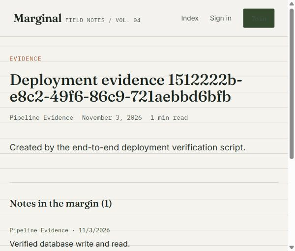

# Validation results — 3 November 2026

## Passed locally

- Backend ESLint check.
- Backend: 19 tests across 2 suites, covering authentication, password hashing, post/comment operations, database error handling, health endpoints and fail-closed secret configuration.
- Backend coverage: 92.73% lines, 91.23% statements, 80.95% functions and 93.05% branches. Unit tests mock database access; this is not a live MySQL integration result.
- Frontend: 7 API-client tests, with 100% coverage of `src/api/client.js`. This does not represent coverage of the React screens.
- Frontend production build using Vite 8.3.5.
- Backend and frontend production dependency audits: zero reported vulnerabilities. Development dependencies still have advisory findings; they are excluded from runtime images.
- Trivy 0.76.1 image scans: both final runtime images pass the HIGH/CRITICAL gate with exit code 0. See the security results below.
- Kubernetes Kustomize rendering and local invariant checks: 21 resources, including the schema generated directly from `database/init.sql`.
- Monitoring Kustomize rendering.
- Random local credentials generated in ignored `.env`; no credential values printed.
- MySQL, Node and nginx public ECR base images fetched successfully after Docker Hub rejected the computer's expired saved token.

## Running local stack — verified

Application: [http://localhost:3000](http://localhost:3000).

`docker compose up --build -d` completed successfully. Frontend, backend and MySQL all report healthy. Only the frontend is published on `127.0.0.1:3000`; API and MySQL have no host port bindings.

The write-mode smoke test passed through nginx → Express → MySQL: register account, log in, create a post, add a comment and fetch the persisted result. The browser also rendered that post and its comment successfully.

### Persistence proof

- Volume: `blogreact_mysql-data`.
- Original MySQL container: `97cc090727b11b2ad9021c23d5882d41a5ac82b1421de61d1e66186fcfb27d3d`.
- Recreated MySQL container: `0b0c7244b7e1a3a0519ffc5b862769c6b4695812cdfc1c0ba5ba61a4b25d4294`.
- Recreation command: `docker compose up -d --force-recreate --no-deps --wait --wait-timeout 120 mysql`.
- Evidence slug: `deployment-evidence-1512222b-e8c2-49f6-86c9-721aebbd6bfb-mw026617`.
- After recreation, the smoke script fetched the same post and confirmed its comment remained present.

### Runtime checks

- Backend runs as UID 1000 (`node`) with a read-only root filesystem.
- Frontend runs as UID 101 (`nginx`).
- MySQL process runs as UID 999 (`mysql`).
- The database Docker network has `Internal=true`.
- Backend `/readyz` returns HTTP 200 and `{"status":"ready"}`.
- Internal `/metrics` returns HTTP 200 and `blogapp_database_up 1`.

### Container vulnerability scans

Trivy 0.76.1 was downloaded from Aqua Security's official GitHub release and its archive SHA-256 was verified against the release checksums before execution. Both images were scanned with `--scanners vuln --severity HIGH,CRITICAL --exit-code 1`, without ignoring unfixed findings.

| Image | Initial HIGH/CRITICAL findings | Final HIGH/CRITICAL findings | Final exit code |
|---|---:|---:|---:|
| blogreact-backend:latest | 6 / 0 | 0 / 0 | 0 |
| blogreact-frontend:latest | 2 / 0 | 0 / 0 | 0 |

The initial backend findings were in unused npm-bundled packages (`brace-expansion` and `undici`). The final backend runtime removes npm, corepack and yarn; dependency installation remains in the build stage. The frontend updates the vendor's `libexpat` package from 2.9.0-r0 to 2.10.0-r0, addressing both reported findings. Both containers still run as non-root users after rebuilding.

Full reports are in `reports/trivy-backend.json` and `reports/trivy-frontend.json` (ignored build artifacts). The original failing scans are retained as `reports/trivy-backend-before.json` and `reports/trivy-frontend-before.json`. [Saved scan summary](evidence/trivy-summary.json) records image IDs and counts. A passing scan means no HIGH/CRITICAL findings were detected by this database at scan time; it does not assert the absence of all vulnerabilities.

### Storage recovery

The initial build failed when C: had approximately 13 MB free and Docker storage became read-only. After space was freed, a stuck WSL data-disk attachment still prevented Docker startup. A user-approved WSL shutdown followed by starting Docker restored the engine without resetting Docker storage or deleting unrelated data. Ubuntu and OpenClawGateway were started again afterward. Keep sufficient free disk space for subsequent builds.

The ignored `.env` already exists. Keep it; rerunning the secret-generation script deliberately refuses to overwrite it.

## Jenkins CI verification on 3 November 2026

Source was pushed to https://github.com/soundar1993s/BlogReact. The local Jenkins job `BlogReact-Local-CI`, build 2, passed for commit `e1cbeeab9079e3485e657634281c527fe0a47774`. All seven stages passed: checkout, dependency installation, test and build, SonarQube analysis, quality gate, Docker build and Trivy security gate. Build 1 failed due to an npm registry idle timeout; build 2 succeeded on retry.

Build 2 ran 19 backend tests and 7 frontend client tests. SonarQube returned quality gate `OK`. Overall analysis showed 66.2% coverage, 0 security issues, 21 reliability issues, 5 maintainability issues and 0.0% duplication. A passing gate does not mean all existing issues are resolved.

The two images `blogapp-backend:2-e1cbeeab9079` and `blogapp-frontend:2-e1cbeeab9079` both passed the HIGH/CRITICAL Trivy gate. The JSON reports are archived with build 2. Screenshots and exported scan summaries are preserved in `C:\Users\Soundar\Desktop\Project-Evidence`.

SonarQube's local webhook destination validation was disabled for this controlled Docker lab so it could call the private Jenkins container hostname. The webhook uses a signing secret stored in Jenkins credentials. Reassess this instance-wide setting before exposing the service externally.

## Live EKS verification on 3 November 2026

- Cluster `blogapp-eks` is ACTIVE in `ap-south-1`, Kubernetes 1.37, with two Ready private t3.large worker nodes. The public API endpoint is restricted to the administrator connection's IPv4 /32; private API access remains enabled. No administrator IP or kubeconfig is committed to Git.
- `BlogReact-EKS-CI` build 4 passed checkout, 26 tests and build, SonarQube analysis, quality gate, Docker build, Trivy gate, ECR publication, EKS deployment and public endpoint validation. Nexus publication was intentionally disabled because ECR is the selected registry. Build 1 skipped publishing due to a branch-condition defect; build 2 failed on registry connectivity. Checkout metadata handling and bounded, idempotent registry retries were added before the verified successful runs.
- Both ECR repositories use immutable tags and scan-on-push. Build 4 deployed `4-e4bbb5be2949` for both frontend and backend. Each Deployment has two Ready replicas. Subsequent documentation commits can trigger newer builds; consult the latest successful Jenkins build and running image references for the current tag.
- Public URL: http://k8s-blogapp-blogappi-e8e48220b4-1416607124.ap-south-1.elb.amazonaws.com. The full smoke test registered a synthetic account, logged in, created a post and comment, and read them back through the public frontend/API path.
- MySQL PVC `data-mysql-0` is Bound to a 10 GiB EBS volume. Deleting and recreating mysql-0 preserved evidence post `deployment-evidence-5d6d2a1d-f623-49fb-a275-9ac3fb9cefa3-mw0ezeq7` and its comment. The first immediate follow-up request returned 500 while the headless service DNS recovered; a later complete smoke check passed. This is persistence evidence, not database high availability.
- Initial frontend availability monitoring recorded 425 HTTP 200 results and one HTTP 502 during build 3's rollout. Namespace ALB readiness-gate injection, frontend/backend preStop delays and a bounded target deregistration delay were then configured. Build 4 deployed successfully with ALB readiness gates present on the frontend pods. The second probe log and final report retain the subsequent monitoring result without erasing the original failure.
- EBS CSI and the AWS Load Balancer Controller are installed with separate IRSA roles. The VPC CNI add-on is ACTIVE with no health issues and `enableNetworkPolicy=true`. The initial OIDC/CNI setup warning was resolved by the configured role association.
- A non-root test pod in the monitoring namespace resolved MySQL's service DNS but its TCP connection timed out as expected, verifying database network isolation. Backend database metrics returned 1 for both replicas.
- The dedicated Jenkins IAM user `blogapp-ci` has access to the two ECR repositories and EKS DescribeCluster. Its EKS access entry maps to namespace-scoped RBAC. `kubectl auth can-i patch deployments -n blogapp` returned yes; direct Secret reads returned no. The pipeline does not use the bootstrap administrator.
- Prometheus/Grafana are running in the monitoring namespace with persistent volumes. The BlogReact dashboard displays CPU, memory, pod status, restarts, node readiness, database connectivity, request rate and latency. Frontend/backend logs and pod CPU/memory evidence were exported.

The screenshot report and raw non-secret execution outputs are preserved in `C:\Users\Soundar\Desktop\Project-Evidence`. Build artifacts, including scan reports and rendered release manifests, remain archived in Jenkins.

## Remaining operational limitations

- This owner-selected demonstration uses HTTP. No owned hostname, issued ACM certificate or HTTPS endpoint has been verified.
- The database is a single StatefulSet replica. Persistent EBS storage is verified, but database failover/high availability and disaster-recovery backups are not implemented.
- Existing SonarQube findings remain: the recorded overall analysis had 66.2% coverage, reliability rating C, 21 reliability issues and 5 maintainability issues. The configured quality gate passed; no deliberate failing Sonar gate was injected during cloud verification.
- Jenkins and SonarQube run on the owner's computer. Automated builds require Docker Desktop, the Jenkins agent, network access and valid CI credentials. The CI access key should be rotated or revoked after assessment. Bootstrap administrator access should be removed after both projects' infrastructure setup and cleanup needs are resolved.
- The cluster, NAT gateway, load balancer, nodes and volumes remain billable while retained for assessment. Review Retain-policy volumes and registry images during an authorized teardown; stopping local Docker does not stop AWS charges.
